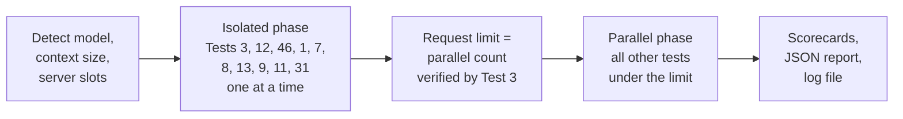

# LLM Eval Suite

[](#run-on-the-host)
[](AGENTS.md#zero-external-dependencies)
[](#quick-start-docker)
[](LICENSE)

Benchmark and qualify any OpenAI-compatible LLM server before you put it into production.

One command tests two things:

- **The server:** verified parallel capacity, prefill and decode speed, prefix caching, abort recovery, and recall at the full configured context.
- **The model:** coding in six languages (compiled and run), reasoning, math, science, medicine, law, writing, tool calling and prompt-injection defense.

It works with [vLLM](https://github.com/vllm-project/vllm), [SGLang](https://github.com/sgl-project/sglang), [llama.cpp](https://github.com/ggerganov/llama.cpp), [Ollama](https://github.com/ollama/ollama), [TGI](https://github.com/huggingface/text-generation-inference), exllama-based servers and commercial APIs. The output is a terminal scorecard, a JSON report, a Markdown decision report and a log file.

## Contents

- [What makes this suite different](#what-makes-this-suite-different)
- [Quick start (Docker)](#quick-start-docker)
- [Latest result](#latest-result)
- [What gets tested](#what-gets-tested)
- [How a run works](#how-a-run-works)
- [Decision report](#decision-report)
- [Qualification suites (Tests 32-48)](#qualification-suites-tests-32-48)
- [Options](#options)
- [Reading the results](#reading-the-results)
- [Running model code safely](#running-model-code-safely)
- [Repository layout](#repository-layout)
- [Development](#development)

## What makes this suite different

| Feature | What it means for you |
|---|---|
| **Measured capacity** | Test 3 sends 1 to 2× the advertised slots at once and reads the server's queue counters. The report states how many requests run in parallel. |
| **Full-context proof** | Test 12 climbs to 98% of the configured context and checks recall at every step. It stops at the first failure and names the error (context rejected, out of memory, timeout). |
| **Code is compiled and run** | Answers in Python, TypeScript, Go, Java, Rust and C# run against test harnesses in the Docker image. Unit tests the model writes must catch seeded bugs (mutation testing). |
| **Self-checked graders** | Every coding test pack has a known-good answer that must pass and a known-bad answer that must fail. CI checks both. |
| **Final answer only** | Graders read the model's final answer, not its reasoning. A truncated answer cannot pass. |
| **No unverified PASS** | If a grader cannot run the code (for example, no compiler), the result is PARTIAL at most. |
| **Server faults are kept separate** | Timeouts, HTTP 5xx and 429 lower the completion rate. They do not lower the model score. If the server goes down, the run stops and the report is marked incomplete. |
| **Phased runs** | Timing tests run alone on an idle server. The other tests then run in parallel, limited to the capacity that Test 3 measured. A full run takes about half the sequential time. |
| **Decision report** | A Markdown report that ranks the use cases the model suits, with evidence and wrong-answer examples. It compares the model with other runs and vendor-published scores, and says how many servers your workload needs. |
| **Your workload, measured** | Test 46 sends your scenario and measures what each user waits for against speed gates. The default is 4 users 3-10 s apart, each with a new 200K-token document, thinking on and a ~2,000-token answer. |
| **Statistics for qualification** | Qualification suites use seeded samples, repeats and 95% confidence intervals, with pass marks from published scores of comparable models. |
| **Zero dependencies, offline** | Python 3.8+ standard library only. All datasets and test frameworks are bundled. Code grading downloads nothing. |

## Quick start (Docker)

The Docker image contains every compiler and test framework that the coding tests need. Use it for full grading.

**Requirements:** Docker, and network access from the host to the LLM server.

```bash
git clone git@github.com:saas-home/llm-eval-suite.git
cd llm-eval-suite
docker build -t llm-eval-suite:latest .
```

**Interactive startup:** on Linux, run:

```bash
./scripts/start_eval.sh
```

The launcher asks for the model endpoint, optional model ID and API key, context
window, optional independent judge, test mode (`all`, `core` or `quick`), coding
language and GPU hardware description. Defaults are every test and all six coding
languages. It checks Docker, offers to build a missing image, asks for confirmation,
probes the model endpoint, then starts the evaluation. An existing image is reused;
rebuild it with the command above after changing the suite.

API-key entry is hidden. Model and judge details are passed through Docker's
`OPENAI_BASE_URL`, `OPENAI_MODEL`, `OPENAI_API_KEY`, `MAX_CONTEXT` and `JUDGE_*`
environment variables; no configuration or credential file is written or mounted.
Blank API-key answers mean no authentication, even if your shell has an existing
key. Docker administrators can still inspect container environment variables.
Reports and logs are saved in this checkout's `results/` and `logs/`, regardless
of where you launch the script. Model code still has the container's network access;
see [Running model code safely](#running-model-code-safely).

For manual commands instead:

**1. Check that the server answers** (under 5 s):

```bash
docker run --rm --network host llm-eval-suite:latest \
  --probe -e http://127.0.0.1:8080/v1
```

**2. Run every test and write the decision report** (several hours):

```bash
docker run --rm --network host \
  -v "$PWD/results:/app/results" \
  -v "$PWD/logs:/app/logs" \
  llm-eval-suite:latest -e http://127.0.0.1:8080/v1 \
  --judge-endpoint http://127.0.0.1:8888/v1 --hardware "1x NVIDIA RTX PRO 6000"
```

For the core tests only (about 30 minutes), add `--suite core`.

**3. Run the coding tests in all six languages, with a separate judge model:**

```bash
docker run --rm --network host \
  -v "$PWD/results:/app/results" \
  -v "$PWD/logs:/app/logs" \
  llm-eval-suite:latest -e http://127.0.0.1:8080/v1 \
  --language polyglot --judge-endpoint http://127.0.0.1:8888/v1
```

The JSON report goes to `./results/` and the log to `./logs/`.

> [!NOTE]
> - `--network host` lets the container reach a server on the host or the LAN.
> - The model name is discovered from `/v1/models`. Use `-m` to choose one.
> - For an API key, add `-e OPENAI_API_KEY=...` to `docker run`, or use `-k`.
> - Without a terminal (`docker run` without `-it`), the tool does not ask questions. It uses the detected or default values.

> [!IMPORTANT]
> The image declares `/app/results` and `/app/logs` as volumes. If you mount the whole repository as `/app`, also mount `./results` and `./logs`. Otherwise the reports go to anonymous Docker volumes.

### Docker image contents

| Component | Version | Source | Used by |
|---|---|---|---|
| Base | Ubuntu 26.04 LTS, `x86_64` and `aarch64` | | |
| Python | 3.14, mypy 1.19 | Ubuntu | All tests, Test 24 |
| Java | OpenJDK 25 (LTS), JUnit 6.1, Mockito 5.24 | Ubuntu, Maven Central | Tests 20-25, 32 |
| Node.js | 26 (LTS) | NodeSource | Tests 20-25, 32 |
| TypeScript | 7.0, Vitest 5.1 | npm | Tests 20-25, 32 |
| Go | 1.27 | go.dev (SHA-256 checked) | Tests 20-25, 32 |
| Rust | 1.99, edition 2024 | rustup (SHA-256 checked) | Tests 20-25, 32 |
| C# | .NET 10 SDK (LTS), xUnit v3 4.0, Moq 4.21 | Microsoft, NuGet | Tests 20-25, 32 |
| Git | 2.53 | Ubuntu | Test 20 (`git apply`) |

The Go, Rust, Node.js and .NET versions are build arguments at the top of the `Dockerfile`. To upgrade, change the argument, rebuild, and run the [test-pack check](#development).

> [!NOTE]
> The Ubuntu 26.04 image runs on any Linux host with Docker 20.10.10 or newer, including Ubuntu 24.04 servers. The container uses the host kernel only.

The frameworks are pinned and installed at build time (`scripts/setup_polyglot_toolchains.sh`). Grading needs no network.

### Docker Compose

`compose.yaml` mounts `./results`, `./logs` and `./config.json`. Create `config.json` first (see [Configuration](#configuration)).

```bash
docker compose run --rm eval -e http://127.0.0.1:8080/v1
```

### Run on the host

Requires Python 3.8+. No `pip install`.

```bash
python3 eval.py --probe -e http://127.0.0.1:8080/v1
python3 eval.py -e http://127.0.0.1:8080/v1
python3 eval.py -e http://127.0.0.1:8080/v1 -q     # short smoke test
```

> [!WARNING]
> On the host, the compilers for TypeScript, Go, Java, Rust and C# are usually missing. Tests 20-25 then use a structural check for those languages, and the result is PARTIAL at most.

To install the tool, run `python3 -m pip install .`. This adds the `llm-eval`, `llm-compare` and `llm-judge` commands, with no third-party dependencies. Installed commands read `config.json` and write `results/` and `logs/` in the current directory. A source checkout uses its own directory.

## Latest result

`Qwen3.8-Flash-Next-FP4` on vLLM (524,288-token context), 2026-11-06. This run is from before the 2026-11-07 test removals, so it scores 27 core tests.

| | |
|---|---|
| Core tests | 25 PASS, 2 PARTIAL, 0 FAIL of 27 scored |
| Capability score | 95.2%, grade A+ |
| Verified parallel requests | 4 |
| Peak prefill | 2,676 tok/s |
| Decode | 34 tok/s for one stream, 88 tok/s total for 4 streams |
| Full context | Recall at every step up to 513,800 tokens (98%) |
| Run time | 1,307 s phased, 2,421 s sequential |

[Full report](results/EVAL_REPORT.md)

## What gets tested

### Core tests (1-31)

Each test has a number, a name for `--test`, and a group for `--suite`. `--suite core` runs these only. Tests 15, 16, 18, 19 and 27-30 were removed on 2026-11-07: larger tests replaced them, or they had too few questions to score (2-10). Their numbers are not reused, so older reports still compare.

#### Serving (`--suite serving`)

| # | Test | What it checks |
|:---:|---|---|
| 1 | Streaming | Time to first token, chunk delivery, decode speed |
| 2 | Vision | Reads 12 fields from an invoice image (`assets/invoice.png`) |
| 3 | Serving capacity | Peak prefill (one request at a time, 2k to 32k tokens). Parallel sweep to 2× the reported slots. Finds requests that wait for a slot. Reports the verified maximum parallel requests and the decode speed for one stream and in total. |
| 7 | Prefix cache | Time to first token for a cold and a warm request with the same prefix |
| 8 | Client abort | Closes the socket during generation, then checks that the next request is served |
| 11 | API errors | Invalid requests get HTTP 400/422, not 5xx |

#### Multi-adapter (`--suite multi_lora`)

| # | Test | What it checks |
|:---:|---|---|
| 31 | Multi-adapter | Routes to several LoRA adapters at once, with no cross-talk. SKIPPED on a single-model server. |

#### Long context (`--suite context`)

| # | Test | What it checks |
|:---:|---|---|
| 12 | Full context | Steps from 4k tokens to 98% of the configured context. Each step hides a value at 85% depth, and the final answer must repeat it. Reports prefill and decode per step. A report-only check then sends long prompts to every verified slot at once and reads the KV-cache size. If the reported KV cache cannot hold every slot at full context, that attempt is not sent, and only the context ÷ slots attempt runs. |
| 13 | Graph search | Multi-hop route through 32k tokens with outdated and revoked distractors. The model must pick the current version of each fact. |

#### API contract and instruction following (`--suite contract`)

| # | Test | What it checks |
|:---:|---|---|
| 5 | Tool calling | Multi-turn function calls with an injected quota error that the model must recover from |
| 6 | JSON schema | Output that matches a schema with `response_format` |
| 9 | Stop words & sampling | The stop word ends the output. Temperature 0 gives the same output 3 times. |
| 10 | Precision | Ledger reconciliation with exact decimals |

#### Coding (`--suite swe`)

| # | Test | What it checks |
|:---:|---|---|
| 4 | Four-task suite | AVL tree, deadlock fix, payment client (each run against a harness), rate-limiter design (rubric) |
| 14 | Algorithm fuzz | Writes a new algorithm, then 5,000 random operations run against it |
| 17 | SWE-bench patch | Fixes a bug. Regression tests must pass. |
| 20 | Surgical diff | A unified diff that `git apply` accepts and that fixes the behavior |
| 21 | Multi-file | Implements an interface with constructor injection, compiled with the real sibling files |
| 22 | Security review | Finds the SQL injection and the race condition. Marks the safe snippet as safe. |
| 23 | Unit-test writing | Tests with mocks must pass on the real code and catch 3 seeded bugs |
| 24 | Strict typing | The strict compiler or `mypy --strict` must accept the code |
| 25 | Safe refactor | Old and new code must give the same output on 10 to 20 inputs |

Tests 20-25 run in one language (`-l python`, the default) or in all six (`-l polyglot`):

| Language | Grading in the Docker image |
|:---|:---|
| Python | Runs the harness, `mypy --strict` |
| TypeScript | `tsc --strict`, Vitest |
| Go | `go test`, `go vet` |
| Java | `javac -Xlint:all -Werror`, JUnit 6 + Mockito |
| Rust | `rustc --test`, `rustc -D warnings` (edition 2024) |
| C# | `dotnet build`, xUnit v3 + Moq, nullable warnings as errors |

**Self-correction (Tests 14, 17, 20, 21, 23, 24, 25).** An answer can fail because of the model: a rejected patch, a compile or type error, or a failing test. The model then gets the error message and tries again, up to 2 times. A fix on the first try, after 1 retry or after 2 retries is a PASS scored 1.0, 0.9 or 0.8. Not fully fixed after 2 retries is a FAIL. An answer that could not be checked, or a failed request, is not retried. Tests 22 (security review) and 32 (MultiPL-E) are graded on the first answer only.

#### Safety

| # | Test | What it checks |
|:---:|---|---|
| 26 | Prompt injection | Ignores instructions hidden in untrusted input. Counts as a safety check in every use case. |

The qualification suites below measure reasoning, medical and writing skills with 50 questions per benchmark. They use MMLU-Pro, MATH-500, BBH, MedQA, full IFEval and others.

### Qualification and workload tests (32-48)

Suites that qualify a model for a use: coding, medical, academic, writing, personal assistant and legal. Test 47 (contract review on full contracts) and Test 48 (summarisation) add document work. Test 46 measures your own workload. They run by default. To run one suite alone, use `--suite <name>`. See [Qualification suites](#qualification-suites-tests-32-48).

## How a run works



1. **Detection.** The tool reads the model list, the context size and the server's slot count. It reads slots from `/health` (`parallel` or `max_slots`), then llama.cpp `/props` (`total_slots`), then `/slots`.
2. **Isolated phase.** Tests that measure time, memory or cache state run one at a time on an idle server. Test 3 runs first and measures how many requests the server runs in parallel.
3. **Parallel phase.** All other tests run at the same time under one limit on requests to the tested model. The limit is `--parallel` or config.json if set. Otherwise it is the count that Test 3 verified, then the server's reported slots.
4. **Report.** The tool prints the scorecards and writes the JSON report and the log.

More rules for the parallel phase:

- Judge requests have a separate limit: `--judge-parallel`, else the judge server's reported slots, else 2.
- With `--language polyglot`, each language of Tests 20-25 is a separate job.
- The output of each test prints as one block when the test ends.
- C# builds (restore and compile) run one at a time, because they share the NuGet folder. The built programs run in parallel.
- Speeds measured in this phase have `measured_under_load: true`. The summary averages use only the isolated tests.

`--sequential` runs every test one at a time in catalog order. The report records the schedule under `schedule`: phases, limits, limit sources, and wall time per phase.

Every test logs when it starts and when it ends, with its duration:

    << finished Test 4 capabilities -> PASS | 20:41:03 to 20:59:09 (18m 06s)

At the end of the run, a **TEST TIMINGS** table lists every test in start order. The report stores the same data under `test_timings`: `started_at`, `finished_at` (ISO 8601 with the UTC offset) and `duration_s` for each job. In the parallel phase, tests overlap, so their durations add up to more than the wall time.

## Decision report

Every run writes `<report>.md` next to the JSON report. It is written for three readers:

| Section | Reader | What it answers |
|---|---|---|
| Summary | Everyone | Use cases ranked from best suited to not recommended, and whether your workload is workable on this server |
| Choosing a model | Someone choosing between models | Verdicts side by side with earlier runs, paired differences on the same questions (with 95% CIs), and scores the vendor publishes |
| Sizing hardware | Someone sizing hardware | Server and version (read from its API), prefill and decode for one user and under load, the workload per user, goodput and servers needed |
| Approving for a team | Someone approving the model for a use | Per use case: verdict, evidence, accuracy with CI, share of questions right on every repeat, checks, and examples of wrong answers |

**Verdicts.** Each of 11 use cases gets one:
- **Recommended** needs all of these:
  - every scored test's 95% CI lower bound at or above its pass mark
  - at least 85% of questions right on every repeat (pass^k)
  - no failed check and no skipped MultiPL-E language
  - at most 5% unscored attempts and 5% unscored items per test (the reasons list any unscored share)
  - at least 40 scored questions
- **Usable with human review** needs every mean at or above its floor.
- **Not recommended** is anything below that.

A use case is as strong as its weakest scored test. Next to the verdict, each use case shows its **low, average and high**. Low and high are the tests furthest below and above their own pass marks. Tests use different scales, so 10% is a pass on SimpleQA but not on MedQA. The average is the item-weighted accuracy. Public benchmarks are labelled, because their items may be in training data. A use case graded without a judge cannot be Recommended.

**Workload (Test 46).** One user runs alone, then all users start with random 3-10 s gaps (fixed seed). Each user sends a new set of contracts with a unique tag at the start, so nothing is cached. Each user asks for one lawyer-labelled clause and a review of about 1,500 words. A user meets the gates when the first token, the complete answer and the decode speed are within the limits. Goodput is the number of users who meet them. "Servers needed" assumes identical servers behind a load balancer.

**Comparison.** `--compare-with results/old.json` (or `compare_reports` in config.json) adds earlier runs. Vendor-published scores come from `data/reference/published_scores.json` when the model family matches. They use the vendor's own harness. Compare them with other vendor scores only, not with a run of this suite.

**Sampling.** `--sampling "temperature=1.0,top_p=0.95,top_k=20"` (or `sampling` in config.json) sets the model card's recommended settings for the repeated benchmarks and Test 46. The report records them.

**Judge check.** With a judge configured, the run checks the judge against public expert ratings (SummEval, LLMBar). The report states the agreement next to every judged result. To compare the judge with your own verdicts, write them to a JSON file (`[{"test", "item", "criterion", "human": true}]`) and set `judge_labels`. The report then also states how often the judge agreed with you.

To rebuild the report, or to compare after the fact:

```bash
python3 report_md.py results/run.json --compare-with results/older.json
python3 report_md.py results/run.json --hardware "Nvidia DGX Spark - 128 GB"   # record the GPUs afterwards
```

## Qualification suites (Tests 32-48)

These suites use seeded samples of official benchmarks and original task sets. Each score has a 95% confidence interval and the share of questions answered right on every repeat. They run by default (`--suite all`). `--suite core` leaves them out.

| Suite | Tests | What it measures |
|---|---|---|
| `coding` | 4, 14, 17, 20-25, 32 | Code that compiles and passes tests in six languages (MultiPL-E and the coding tests) |
| `medical` | 33-36 | MedQA (USMLE), MedMCQA, PubMedQA, MMLU medical subjects |
| `academic` | 37-39 | MMLU-Pro, MATH-500, BIG-Bench Hard |
| `writing` | 40, 41, 48 | Full IFEval, emails, texts and social posts, summaries of US bills (BillSum) |
| `personal` | 42-44 | SimpleQA (facts without search), XSTest (over-refusal), everyday assistant tasks |
| `legal` | 45, 47 | LegalBench CC-BY-4.0 tasks. Clause questions on full contracts (CUAD, lawyer-labelled). A third of the questions ask for a clause that the contract does not have. |
| `qualification` | all of the above | |
| `workload` | 46 | Your workload: concurrent users with long new documents, against speed gates (runs alone, before the parallel phase) |

```bash
# Medical, 50 items × 3 repeats (defaults)
docker run --rm --network host -v "$PWD/results:/app/results" llm-eval-suite:latest \
    -e http://127.0.0.1:8080/v1 --suite medical

# Writing with a separate judge, smaller sample
docker run --rm --network host -v "$PWD/results:/app/results" llm-eval-suite:latest \
    -e http://127.0.0.1:8080/v1 --suite writing --samples 20 --repeats 1 \
    --judge-endpoint http://judge-host:8080/v1
```

- **Run time.** Each benchmark asks `samples × repeats` questions. MultiPL-E asks that many per language. On a local 30B reasoning model, the full `qualification` suite at the defaults takes several hours. `--samples 10 --repeats 1` is faster, with wider intervals.
- **Judge.** The LLM judge scores only writing tasks, personal-assistant tasks, summaries, SimpleQA answers that are not an exact match, and long XSTest refusals. Code, medical, academic and legal scores never use it. The tested model never grades its own answers.
- **Without a judge** (no `--judge-endpoint`), or once the judge goes down or stops responding (no answer for 120 s), judged items are graded objectively:

  | Test | Objective grading |
  |---|---|
  | 41, 44 writing and personal tasks | Code checks only (length, format, required words). Items with no code check are left out and counted as unscored. |
  | 42 SimpleQA | Correct only if every word of the gold answer is in the answer (paraphrases count as wrong) |
  | 43 XSTest | The refusal phrase decides, as in the XSTest paper's string match |
  | 48 Summarisation | A reference point counts as covered when half of its content words appear. Invented statements are not detected. |

  Results graded this way say "no judge" or "partly no judge", and their use case cannot be Recommended.
- **Judge check.** With a judge, the run also checks the judge against expert ratings in the background. It uses 40 SummEval summaries (faithfulness) and 40 LLMBar answer pairs (instruction following), both MIT-licensed and bundled. The report states how often the judge agreed.
- **Data** is in `data/suites/`. Sources, licenses and checksums are in [`data/suites/SOURCES.md`](data/suites/SOURCES.md). To download it again, run `python3 scripts/fetch_benchmark_data.py`.

<details>
<summary><b>Pass marks per benchmark</b></summary>

The marks come from published scores of comparable models (`PASS_MARKS` in `suites.py`). Each result records its marks and their source. The summary scores each benchmark as accuracy ÷ pass mark, with a maximum of 100%. The published scores use full test sets and few-shot prompts. This suite uses zero-shot prompts on a sample, so the marks are approximate.

| Benchmark | PASS at | PARTIAL at | Reference |
|---|---|---|---|
| MultiPL-E | 75% | 55% | Qwen2.5-72B-Instruct 75.1; Qwen2.5-32B base 59.4 |
| MedQA (USMLE) | 75% | 60% | Med-PaLM 2 86.5, GPT-4 86.1; USMLE pass mark about 60% |
| MedMCQA | 65% | 50% | Med-PaLM 2 72.3 |
| PubMedQA | 72% | 60% | Med-PaLM 2 81.8, human expert 78.0; majority baseline about 55% |
| MMLU medical | 80% | 65% | GPT-4 / Med-PaLM 2 about 87 to 95 |
| MMLU-Pro | 65% | 45% | Gemma 3 27B 67.5, Qwen2.5-72B 71.1, GPT-4o 72.6 |
| MATH-500 | 80% | 60% | Gemma 3 27B 89.0, Qwen2.5-72B 83.1 |
| BIG-Bench Hard | 80% | 60% | GPT-4 83.1 |
| IFEval (prompt, strict) | 75% | 60% | GPT-4 76.9, Gemma 3 27B 90.4 |
| SimpleQA (correct) | 10% | 5% | Gemma 3 27B 10.0, GPT-4o-mini 8.6, GPT-4o 38.2 |
| XSTest | 90% | 80% | Well-calibrated chat models above 90% |
| LegalBench | 75% | 60% | GPT-4 about 77 |
| Contract review (CUAD) | 80% | 60% | No published score for this format: at most 1 in 5 clauses missed or invented |
| Summarisation (BillSum) | 70% | 50% | No published score for this format: most reference points, nothing invented |
| Writing and personal tasks | 80% | 50% | Original items, no published reference |

</details>

## Options

### Selecting tests

```bash
--suite all          # default: every test, the full decision report
--suite core         # Tests 1-31 only
--suite serving | contract | context | swe | multi_lora               # core groups
--suite coding | medical | academic | writing | personal | legal | qualification | workload
--test 3,12          # by number
--test 20-25         # by range (removed numbers are skipped)
--test context_scaling,workload   # by name
--exclude 2          # text-only endpoint: skip vision
--exclude 12,13,46   # skip the long-context tests
-l polyglot          # Tests 20-25 in all six languages
-q                   # short smoke test
```

### Parallel and judge

```bash
--parallel 8                       # request limit (default: verified by Test 3)
--sequential                       # one test at a time
--judge-endpoint http://host/v1    # separate judge model
--judge-parallel 2                 # judge request limit
```

### Configuration

Put run settings in `config.json` (or `.env`). A CLI flag overrides the file.

```json
{
  "endpoint": "http://127.0.0.1:8080/v1",
  "model": "Qwen3.8-27B",
  "max_context": 32768,
  "parallel": 4,
  "suite": "all",
  "exclude": "2",
  "language": "polyglot",
  "judge": {"endpoint": "http://127.0.0.1:8888/v1"},
  "adapters": ["finance-lora", "legal-lora", "medical-lora"],
  "hardware": "1x NVIDIA RTX PRO 6000 96 GB",
  "sampling": {"temperature": 1.0, "top_p": 0.95, "top_k": 20, "source": "Qwen model card, thinking mode"},
  "max_output_tokens": 32768,
  "workload": {"prompt_tokens": 200000, "users": 4, "answer_tokens": 2000, "stagger_s": [3, 10],
               "gates": {"first_token_s": 90, "complete_s": 300, "per_user_tok_s": 15}},
  "compare_reports": ["results/previous_run.json"],
  "judge_labels": "data/judge_labels.json"
}
```

`max_output_tokens` (or `--max-output-tokens`) is the output budget per answer, thinking included, for the coding and accuracy tests. The default is 32,768. Thinking models can need more. For example, Qwen3.8-Flash-Next's card allows 262,144 reasoning tokens. The tool caps the budget so that the estimated prompt, a safety margin and the answer fit the context. The estimate cannot guarantee a fit for every tokenizer. Sometimes fewer than 1,024 tokens are left for the answer, or less than a smaller requested budget. Then the core test is skipped, or the qualification item is left unscored. The model does not fail on an answer the context cut off. If a self-correction retry no longer fits, the earlier graded attempt counts. Test 46 uses its `workload` setting.

Test 46 is skipped with a reason if its output budget and a full focus contract cannot fit the server's context window. Reduce the workload's `max_output_tokens` or use a server with a larger context.

The Docker image does not contain `config.json`. Mount it (`-v "$PWD/config.json:/app/config.json:ro"`) or use the flags `--sampling`, `--hardware`, `--max-output-tokens` and `--compare-with`.

```bash
python3 eval.py --config config.json
python3 eval.py --config config.json --quick --suite serving
```

`config.json.example` shows the two-server form for `compare.py --live`. git ignores `config.json` because it can contain API keys.

### Comparing models

```bash
# Two saved reports, or three or more
python3 compare.py results/modelA.json results/modelB.json -o comparison.md

# Two live servers, side by side
python3 compare.py --live \
  --endpoint1 http://127.0.0.1:8080/v1 --model1 model-a \
  --endpoint2 http://10.0.0.2:8000/v1 --model2 model-b -o arena.md

# Independent 10-point code-quality judge for the configured model
python3 judge_eval.py --single \
  --judge-endpoint http://127.0.0.1:8888/v1 --judge-model judge-model
```

The standalone 10-point judge (`judge_eval.py` or `llm-judge`) needs a judge that is not one of the tested models.

- **Judge settings.** Use `--judge-endpoint`, `--judge-model` and `--judge-api-key`. You can also use the `judge` object in `config.json`, or the `JUDGE_ENDPOINT`, `JUDGE_MODEL` and `JUDGE_API_KEY` environment variables. CLI flags override the file, and the file overrides the environment.
- **Judge model.** If you omit it, the tool tries to discover it. One endpoint can serve the judge and a tested model if they are different models.
- **Scoring.** A failed request or an invalid score leaves the task unscored. A model gets a rank only if all its tasks have a score. An empty answer is the model's failure: it scores 0, and the judge still scores the other model's answer.
- **Incomplete runs.** If a server is unreachable, the tool sends no more tasks. It writes the reports and exits with code 3.
- **Output throughput.** Generated tokens divided by the full wall time of the request, prompt processing included. It averages successful answers only. If the server does not report usage, the tool estimates the token count. If no answer was measured, it reports N/A (`null` in JSON).

### Other commands

```bash
python3 eval.py --history       # list earlier runs in results/
python3 eval.py --leaderboard   # rank earlier runs by efficiency index
python3 eval.py --help          # all options
```

## Reading the results

Each run prints a model-quality scorecard and a serving scorecard. Output from the 2026-11-06 run:

```text
             MODEL COGNITIVE CAPABILITY & INTELLIGENCE SCORECARD
  Model Under Test        : Qwen3.8-Flash-Next-FP4
  Intelligence Grade      : A+ (Frontier Intelligence)
  Pure Capability Score   : 95.2%  [19/21 Tasks Solved (95.2%)]
  Overall Task Accuracy   : 25/27 Passed (96.3%)
  Solution Conciseness    : 4150.5 tokens/passed task (Token Economy)

             HOSTING INFRASTRUCTURE & SERVING PERFORMANCE SCORECARD
  Target Serving Endpoint : http://<model-server>:8080/v1
  Mean Decode Throughput  : 50.16 tok/s
  Mean Prefill TTFT       : 386.9 ms
  Concurrent Clients      : 4 active parallel stream(s)
  Total Suite Wall Time   : 1307.33 s
  Total Solution Tokens   : 118,536 tokens consumed
  Serving Efficiency Idx  : 80.2 / 100.0 (Throughput & conciseness rating)
```

With `-l polyglot`, a language matrix follows:

```text
Language     | Diff(20)   | Multi(21)  | Sec(22)    | Test(23)   | Type(24)   | Refactor(25) | Pass Rate
Python       | PASS       | PASS       | PASS       | PASS       | PASS       | PASS         | 6/6 (100%)
TypeScript   | PASS       | PASS       | PASS       | PASS       | PASS       | PASS         | 6/6 (100%)
Go           | PARTIAL    | PASS       | PASS       | PARTIAL    | PASS       | PASS         | 4/6 (67%)
Java         | PASS       | PASS       | PASS       | PASS       | PASS       | PASS         | 6/6 (100%)
Rust         | PARTIAL    | PASS       | PASS       | PASS       | PASS       | PASS         | 5/6 (83%)
C#           | PASS       | PASS       | PASS       | PASS       | PASS       | PASS         | 6/6 (100%)
```

The report also has a workload matrix. It rates the model for agents, coding, math and science, medical, writing, long context, vision and serving.

<details>
<summary><b>Metric definitions</b></summary>

- **Test score.** PASS is 1, PARTIAL is 0.5, FAIL is 0. A test with several items scores its accuracy (8 of 10 correct is 0.8).
- **Capability score and grade.** The average score of the model-quality tests. These are all tests except 1, 3, 7, 8, 9, 11 and 31. Decode speed has no effect on it. Grades: A+ at 90% or more, A at 80%, B+ at 70%, B at 60%, C at 50%, else F.
- **Effectiveness ("Overall Task Accuracy").** The average test score over completed tests. Tests with server faults are left out.
- **Completion rate.** The share of tests that finished without a server fault (network error, HTTP 5xx, 429).
- **Token economy.** Tokens generated by passed tests ÷ (passed tests + 0.5 × PARTIAL tests). Lower means more concise.
- **Mean decode throughput and mean TTFT.** Averages over the tests that report them. In a phased run, only isolated tests count.
- **Stream decode timing.** Decode throughput uses the time between the first and last generated chunks. If only one chunk arrives, the tool cannot measure throughput and reports zero.
- **Efficiency index (0 to 100).** The sum of three parts, with a maximum of 100:
  - 0.6 × effectiveness
  - 0.25 × speed score (1.5 × decode tok/s, maximum 100)
  - 15 × conciseness factor (1,000 ÷ token economy, from 0.2 to 2)
- **Server telemetry.** The report reads Prometheus `/metrics` if the server has it (for example vLLM or SGLang). It records resident memory, running and waiting requests, KV-cache use, LoRA deferred queue and preemptions.

</details>

### If the tested server goes down

The tested server can stop accepting connections during a run (connection refused, host unreachable, name not resolved). The tool then retries the request after 5, 10 and 15 seconds, so a server restart or model reload does not end the run. If the server still does not answer, the run stops:

1. The log prints `[SERVER DOWN]`. No more requests go to the server.
2. Tests that are already running end with an infra failure. Tests that have not started are not run.
3. The JSON report is still written. `"incomplete"` gives the reason and lists the tests that did not run. Those tests show as SKIPPED.
4. The program exits with code 3, so the container stops.

Timeouts and HTTP 5xx do not stop the run, because a busy server can recover from them.

## Running model code safely

> [!WARNING]
> Tests 4, 14, 17, 20, 21, 23, 25 and 32 run code that the model wrote. Run untrusted models in the Docker image.

In the Docker image, the suite runs as root, and model code runs as the user `evalcode` (uid and gid 64999). That user owns only the folder of the current run, so model code:

- cannot write to `results/` or `logs/`, so it cannot change a report
- cannot read files that only their owner can read. Set `chmod 600 config.json .env` on the host before you mount them.
- can read other files in the container that every user can read
- can reach the network with the same access as the container (`--network host` in the examples above)

The suite also removes environment variables with credential-like names (`*KEY*`, `*TOKEN*`, `*SECRET*` and similar), and a time limit and an output cap stop runaway code.

On the host, model code runs as your own user and can read and write everything you can. If you run the suite as root outside the image, create the user first (see the `Dockerfile`), or the suite warns and runs model code as root. `EVAL_CODE_USER` selects a different user.

For an untrusted model, also use a dedicated host or VM, and give the container network access to the model server and the judge only.

To disable code execution:

```bash
python3 eval.py -e http://127.0.0.1:8080/v1 --no-execute
# or
EVAL_SAFE=1 python3 eval.py -e http://127.0.0.1:8080/v1
```

With execution disabled:

- Tests 4, 14, 17, 20, 21, 23 and 25 check only the syntax and structure of the code. A check that does not run the code cannot show that it works, so these tests give PARTIAL at most, never PASS.
- Test 24 still runs `mypy --strict` on Python answers. mypy reads the code and does not run it.
- Test 32 (MultiPL-E) is SKIPPED. It is scored only by running the code, so the suite sends no requests.

Scores from a run with `--no-execute` are not comparable with scores from a run that executes code.

The standalone probes in `benchmarks/` follow these rules:

- `adversarial.py` and `code_synthesis.py` run model code. `EVAL_SAFE=1` disables execution, and syntax-only checks then give PARTIAL at most.
- The adversarial YAML check can verify only simple scalar mappings without a YAML dependency. Other formats give PARTIAL.
- `adversarial.py`, `code_synthesis.py`, `precision.py` and `needle_recall.py` report a failed request as ERROR and exit with code 3. If the server is unreachable, they stop and list the checks that did not run.
- `reasoning.py` checks topic coverage only, not whether the reasoning is correct. A matching answer gives PARTIAL.
- `reasoning.py` and `concurrency.py` calculate total decode speed over the time span of the generated chunks. `concurrency.py` also reports the mean rate per client.
- `context.py` accepts `--out` for JSON results. If the server does not report usage, it marks prompt-token counts as estimated.

## Repository layout

| Path | Content |
|---|---|
| `eval.py` | Main program: core tests, scheduler, CLI |
| `suites.py`, `judge.py`, `ifeval.py` | Qualification suites (Tests 32-45, 47-48), LLM judge, IFEval verifier |
| `workload.py` | Test 46: your workload of concurrent users with long documents |
| `usecases.py`, `report_md.py` | Use-case verdicts and the Markdown decision report |
| `judge_validation.py` | Checks the judge against expert-rated SummEval and LLMBar data |
| `languages.py`, `polyglot.py` | Prompts and compile-and-run graders for six languages |
| `client.py` | HTTP client, retries, request limit, logging, server metrics |
| `reporting.py` | Scoring, scorecards, comparison |
| `compare.py` | Compares reports or live servers |
| `judge_eval.py` | Standalone 10-point code-quality judge |
| `env_loader.py`, `domain_benchmarks.py` | config.json and `.env` loading, shared answer extraction |
| `benchmarks/` | Standalone probe scripts |
| `data/` | Bundled datasets and coding test packs |
| `scripts/` | Data download, toolchain setup, test-pack check |
| `tests/` | Unit tests (`unittest`) |
| `results/`, `logs/` | Run output. git ignores these folders, except `results/EVAL_REPORT.md` and the JSON report it describes. |

[AGENTS.md](AGENTS.md) has the rules for contributors. [CHANGELOG.md](CHANGELOG.md) lists the changes.

## Development

```bash
# Unit tests (standard library unittest)
python3 -m unittest discover -s tests -v

# Syntax check of all modules
python3 -m py_compile *.py benchmarks/*.py tests/*.py

# Check that every coding test pack passes good code and fails bad code
docker run --rm --network none -v "$PWD:/app" --entrypoint python3 \
    llm-eval-suite:latest scripts/verify_polyglot_packs.py
```

## License

[Apache License, Version 2.0](LICENSE).
